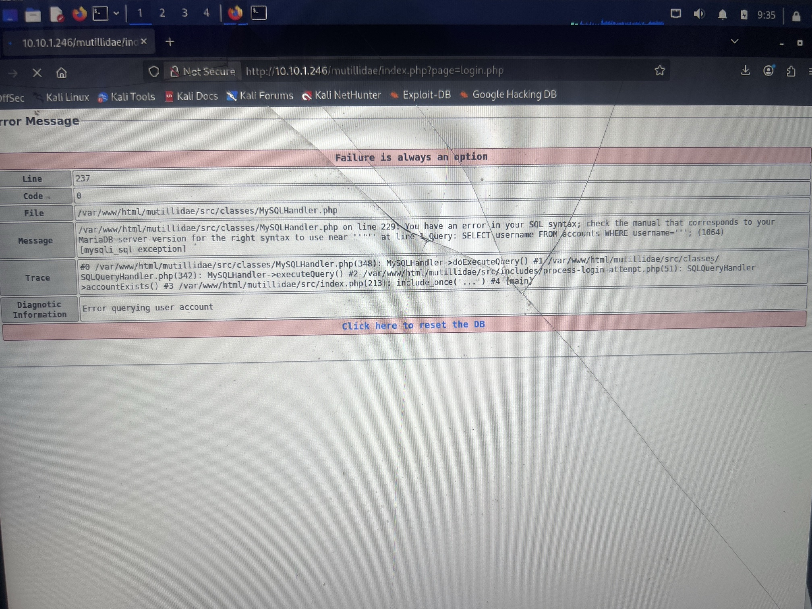
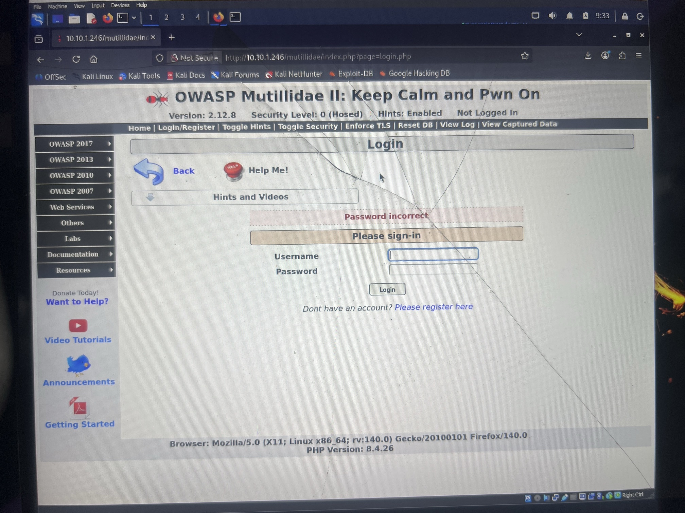
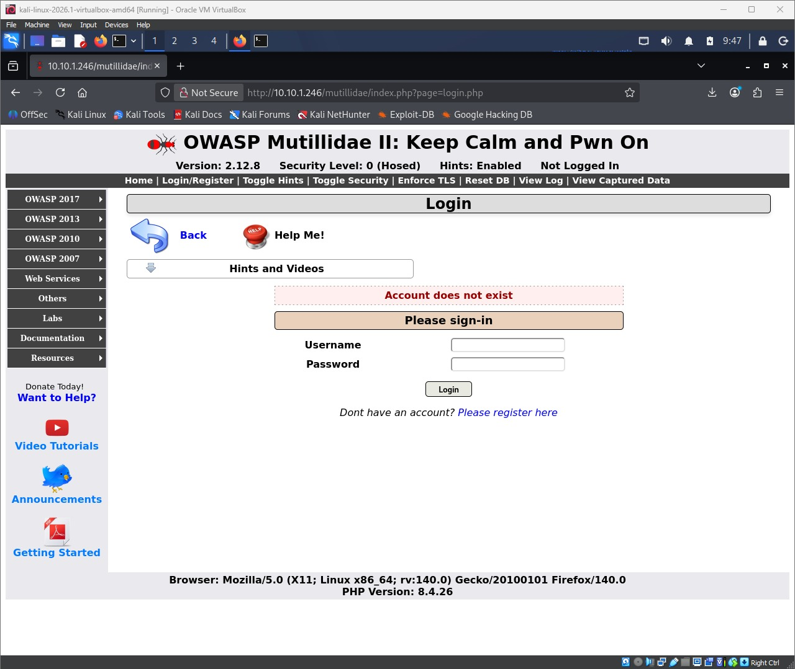
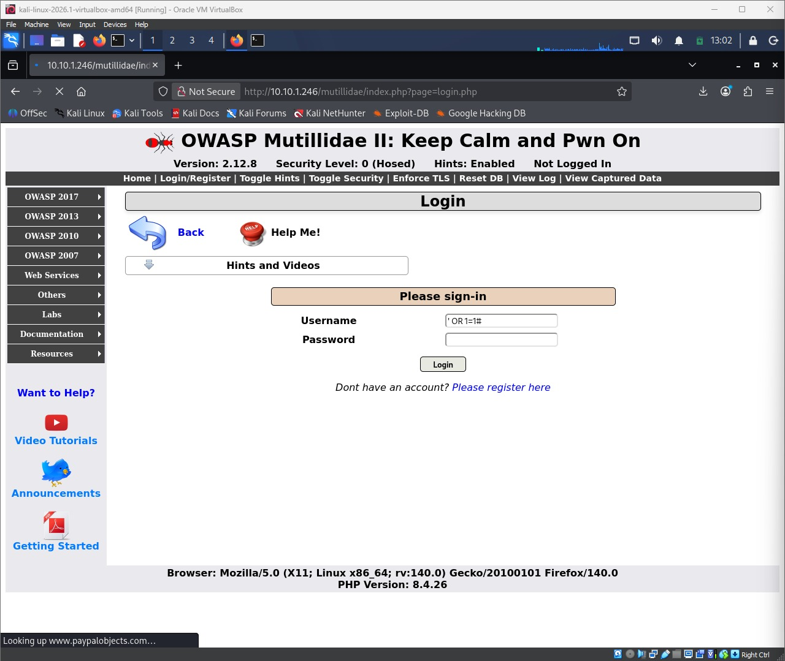
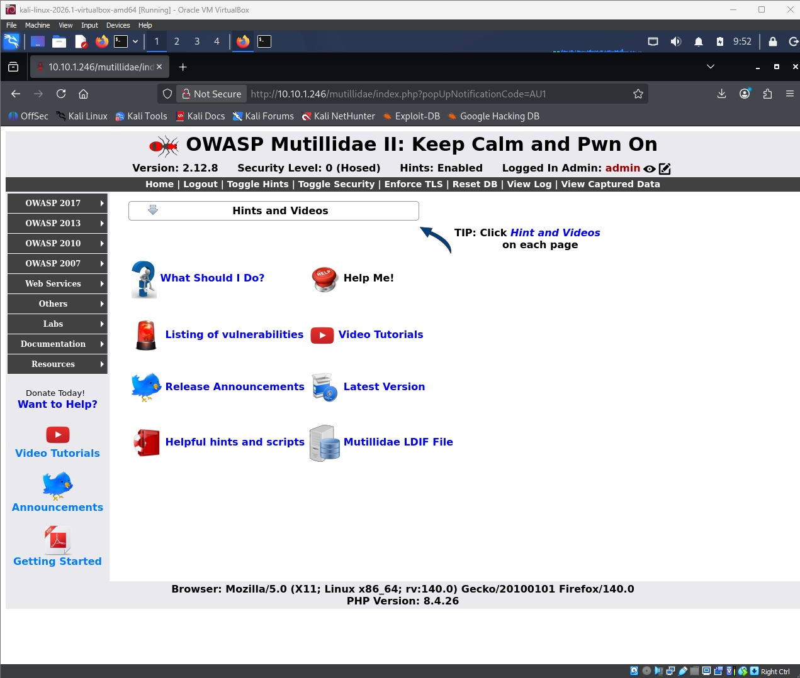
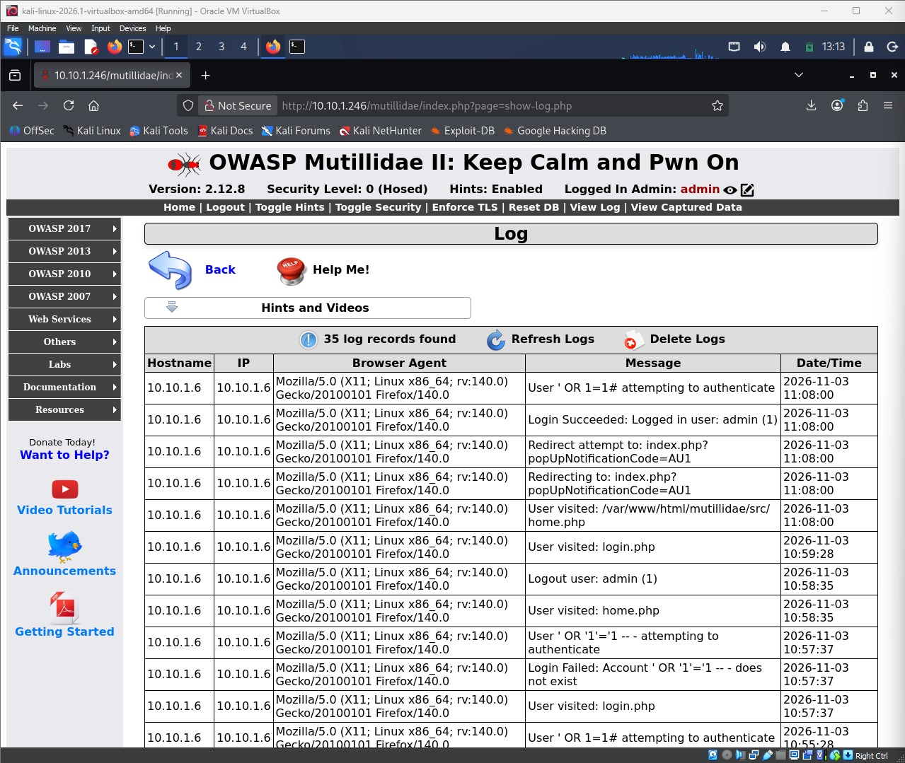

# Task 1 — SQL Injection — Gaining Access

## 1. Objective

Identify and exploit a SQL-injection vulnerability in OWASP Mutillidae II (hosted on tc-corp-server) to bypass authentication or extract data, and document the full process and every payload used until the one that successfully gained access.

**Target:** OWASP Mutillidae II login page, tc-corp-server lab VM (IP: 10.10.1.246), from Kali attacker workstation (IP: 10.10.1.6)

## 2. Methodology (step by step)

1. Browsed to the Mutillidae login page (`index.php?page=login.php`) and chose the **Username** field on the login form as the target input, since it is the first point of user-controlled data processed before any session is established.
2. Submitted a normal-looking credential pair (a plausible username and password) as a baseline to observe standard application behaviour — the app returned a generic "Password incorrect" message.
3. Submitted a single quote (`'`) alone in the Username field to test whether the input was sanitised. The application returned a raw MariaDB syntax error, exposing the underlying query: `SELECT username FROM accounts WHERE username='...'`. This confirmed the Username field was concatenated directly into a SQL query with no parameterisation or escaping.
4. Attempted an authentication-bypass payload, `' OR '1'='1`, which did not succeed alone — the application performs a separate check (an `accountExists()` query) before validating the password, so satisfying only the existence check wasn't sufficient.
5. Attempted `' OR '1'='1' -- -` to comment out the remainder of the query; this returned an "Account does not exist" response, suggesting the comment sequence or escaping did not behave as expected in that attempt.
6. Simplified the payload to `' OR 1=1#`, using `#` as the MySQL/MariaDB single-line comment marker instead of `--`. Submitted this in the Username field with the Password field left blank.
7. This payload succeeded: the application logged the session in as the `admin` account, confirmed by the banner reading "Logged In Admin: admin" in the top menu bar.
8. Reproduced the successful payload a second time from a clean login form to confirm it was consistently repeatable, and captured before/after screenshots of that run.
9. Checked Mutillidae's built-in request log (**View Log**) while logged in as `admin`, which independently corroborated the attack sequence at the server level: the log recorded `User ' OR 1=1# attempting to authenticate` immediately followed by `Login Succeeded: Logged in user: admin (1)`, and separately recorded the earlier failed attempt as `User ' OR '1'='1' -- - attempting to authenticate` → `Login Failed: Account ' OR '1'='1' -- - does not exist`.

## 3. Payloads / commands tried (in order)

| # | Payload / input | Field | Result |
|---|---|---|---|
| 1 | `'` | Username | MariaDB syntax error returned, exposing query structure: `SELECT username FROM accounts WHERE username='...'` — confirms unsanitised input |
| 2 | `' OR '1'='1` | Username | Login failed ("Password incorrect") — satisfies the username-exists check only, not the separate password validation |
| 3 | `' OR '1'='1' -- -` | Username | Login failed ("Account does not exist") |
| 4 | `' OR 1=1#` | Username | **Successful — logged in as `admin` without a valid password** |

<!-- Add any further rows if you tried more variants. Keep them in the exact order you tried them. -->

## 4. Evidence (screenshots)

Note: Single quote submitted in the Username field returns a raw MariaDB syntax error, exposing the underlying query and confirming the field is unsanitized.

Note: Baseline — a normal login attempt returns a generic "Password incorrect" message, establishing standard application behaviour before injection testing.

Note: An earlier payload variant, `' OR '1'='1' -- -`, returned "Account does not exist" — a failed attempt logged as part of the ordered payload trail.

Note: The successful payload, `' OR 1=1#`, entered in the Username field immediately before submission.

Note: Successful authentication bypass — logged in as "admin" without a valid password, confirmed by the "Logged In Admin: admin" banner.

Note: Mutillidae's internal log independently records the successful payload (`' OR 1=1#`) and its outcome (`Login Succeeded: Logged in user: admin (1)`), alongside the earlier failed `' OR '1'='1' -- -` attempt — corroborating the browser-side evidence above.

## 5. Analysis

SQL injection occurs when user-supplied input is inserted directly into a SQL query string instead of being treated strictly as data, allowing an attacker to change the structure and logic of the query itself. In this case, the Mutillidae login form built its query by concatenating the submitted Username value directly into a string like `SELECT username FROM accounts WHERE username='<input>';` with no parameterisation, escaping, or input validation.

Submitting a single quote confirmed this: it closed the opening quote early and broke the SQL syntax, which the database reported back as an error — directly leaking the query's structure.

The successful payload, `' OR 1=1#`, exploited this the same way but constructively: the closing `'` ended the intended string literal, `OR 1=1` added a condition that is always true, and `#` is a MySQL/MariaDB comment marker that caused the database to ignore everything the application appended after my input (including the trailing closing quote and semicolon). The effective query became `SELECT username FROM accounts WHERE username='' OR 1=1` — a condition that matches every row in the `accounts` table. Because the application's account-lookup logic treated the first/any matching row as valid, and the password check never meaningfully constrained the result, this was sufficient to authenticate as the `admin` account without ever supplying a valid password.

## 6. Remediation / defence

- **Use parameterised queries / prepared statements** (or a well-vetted ORM) for all database access, so user input is always bound as data and can never alter query structure, regardless of what characters it contains.
- **Apply least-privilege database accounts** for the application, so even if injection occurs the account used cannot read or modify data outside what the application legitimately needs.
- **Validate and allow-list input** server-side (e.g. reject unexpected characters in a username field) as defence-in-depth, though this should never be relied on as the sole protection.
- **Suppress verbose database error messages** in production; the raw MariaDB error returned here handed an attacker the exact table/query structure, which materially sped up the attack.
- **Decouple authentication logic from a single existence-based query** — verify both username and password together server-side (e.g. via a hashed password comparison after a single parameterised lookup) rather than relying on separate existence and credential checks that can be individually bypassed.
