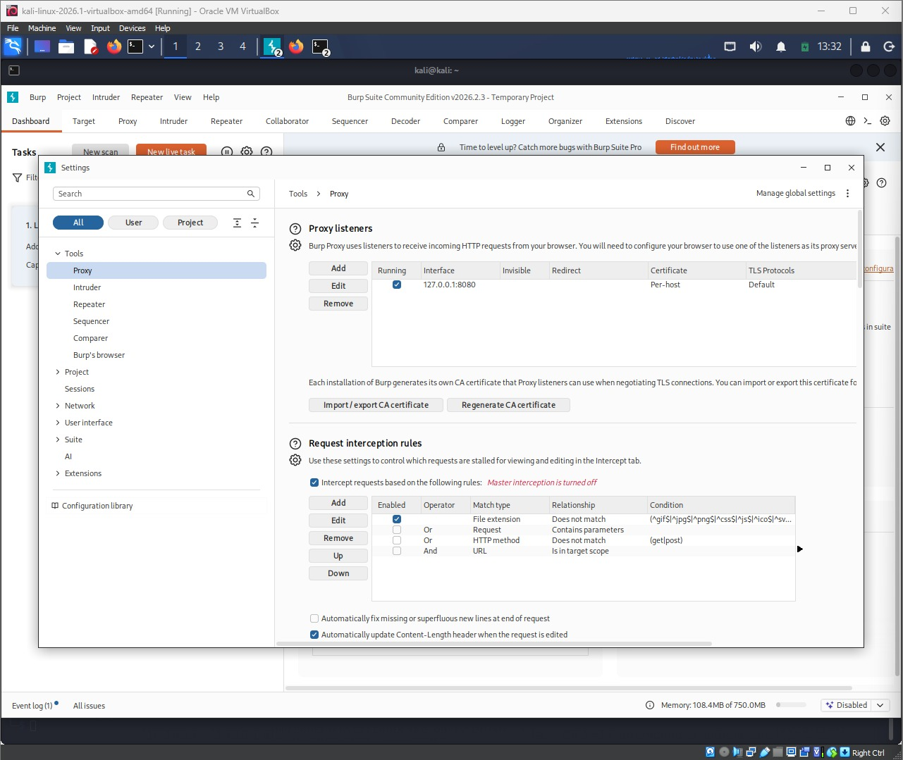
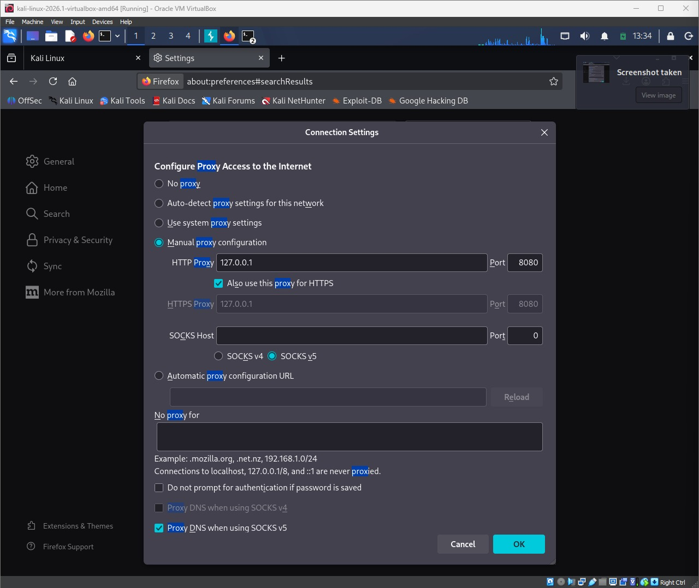
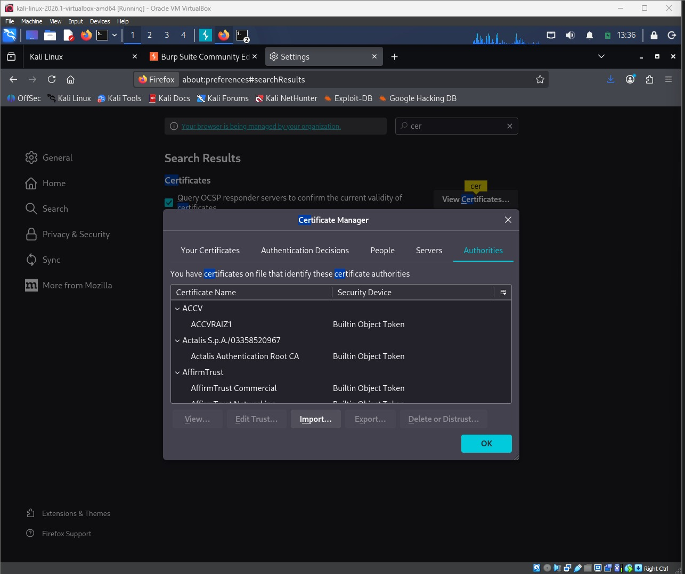
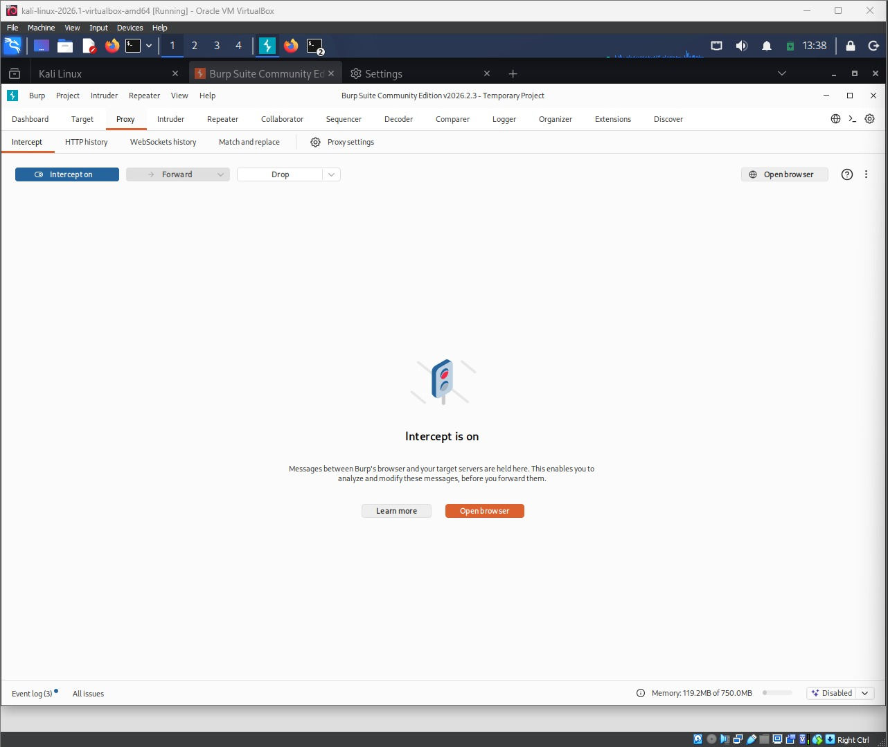
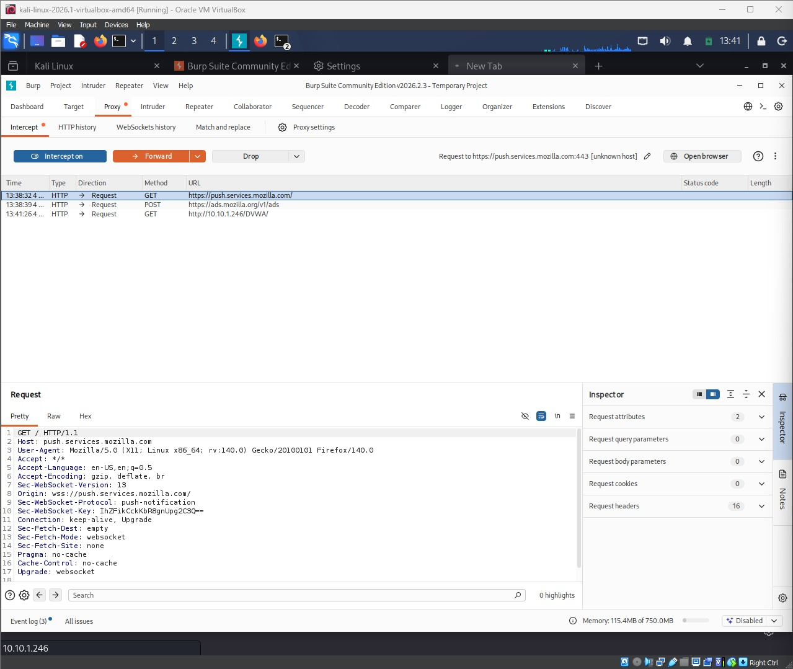
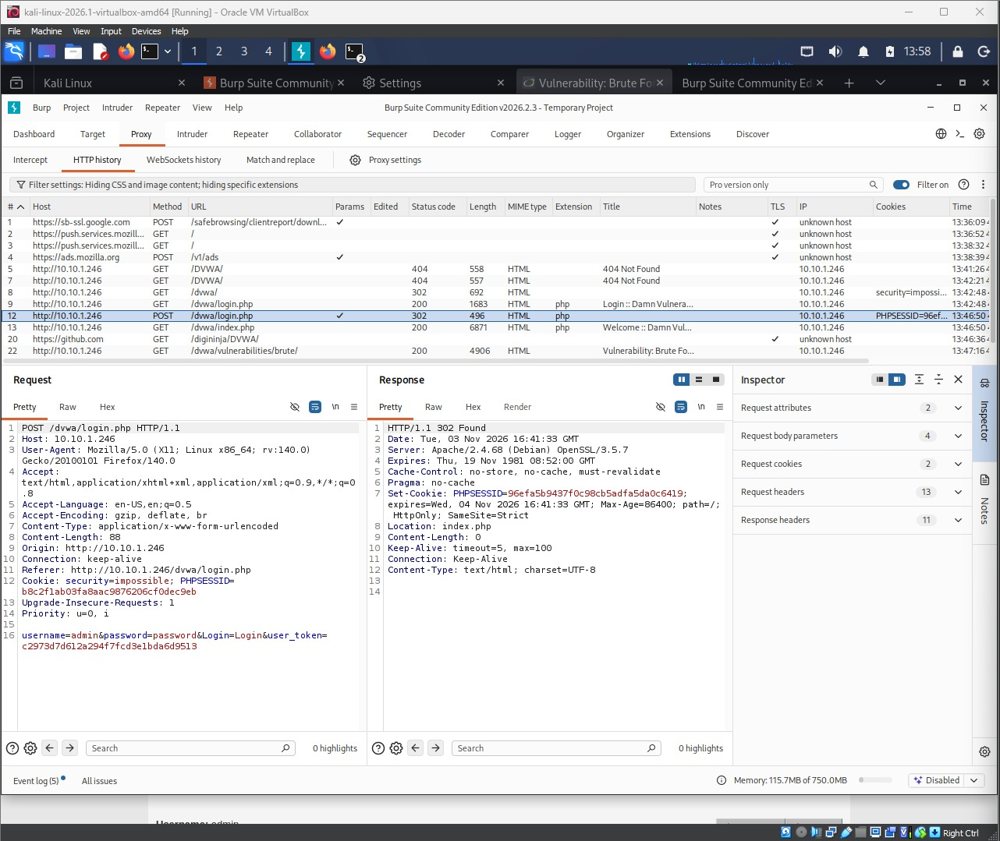

# Task 2 — HTTP Interception & Traffic Analysis

## 1. Objective

Configure Firefox to proxy through Burp Suite, capture the HTTP traffic generated while browsing DVWA, analyse it, and identify and document the HTTP form(s) the application uses.

**Target:** DVWA, hosted on tc-corp-server lab VM (IP: 10.10.1.246), browsed from Firefox on Kali (IP: 10.10.1.6).

## 2. Methodology (step by step)

1. Opened Burp Suite Community Edition and confirmed, under Proxy > Proxy settings > Proxy listeners, that a listener was running on `127.0.0.1:8080`.
2. Configured Firefox's connection settings (Settings > General > Network Settings > Settings) to Manual proxy configuration, setting the HTTP Proxy to `127.0.0.1:8080` with "Also use this proxy for HTTPS" enabled, so all browser traffic — HTTP and HTTPS — would route through Burp.
3. Installed Burp's CA certificate into Firefox's trusted Certificate Authorities (Settings > Privacy & Security > Certificates > View Certificates > Authorities > Import), so HTTPS traffic could also be decrypted and inspected rather than just tunnelled blind.
4. Turned Burp's Proxy > Intercept to "on" and confirmed it was holding live requests before they reached the server.
5. Browsed to `http://10.10.1.246/DVWA/` in Firefox and confirmed the request appeared in Burp's Intercept tab, proving the proxy chain (Firefox → Burp → target) was working end to end.
6. Turned Intercept off so pages would load normally, then browsed DVWA fully: loaded the login page, submitted valid credentials to log in, landed on the DVWA welcome page, and visited the "Brute Force" vulnerability module page.
7. Reviewed the full traffic trail in Burp's Proxy > HTTP history, which listed every request made to `10.10.1.246`, including the login POST and subsequent authenticated GET requests.
8. Selected the `POST /dvwa/login.php` entry and inspected its Request tab in full, revealing the exact form submission: method, headers, cookies, and URL-encoded body parameters.
9. Selected the `GET /dvwa/vulnerabilities/brute/` entry to show a representative authenticated GET request, including the session cookie (`PHPSESSID`) and DVWA security-level cookie (`security=impossible`) sent automatically on every subsequent request.

## 3. Payloads / commands tried (in order)

| # | Action | Input submitted | Result |
|---|---|---|---|
| 1 | Visited `http://10.10.1.246/DVWA/` (wrong case) | — | 404 Not Found |
| 2 | Visited `http://10.10.1.246/dvwa/` | — | 302 redirect to `login.php`, `security=impossible` cookie set |
| 3 | Loaded DVWA login page | — | 200 OK, login form rendered |
| 4 | Submitted login form | `username=admin`, `password=password`, `Login=Login`, `user_token=<CSRF token>` | 302 Found → redirected to `index.php`; new `PHPSESSID` session cookie issued |
| 5 | Visited `index.php` (post-login) | — | 200 OK, "Welcome :: Damn Vulnerable Web Application" |
| 6 | Visited `/dvwa/vulnerabilities/brute/` | — | 200 OK, Brute Force module page loaded, authenticated session cookies sent automatically |

## Identified form(s)

| Form | Method | Action (endpoint) | Parameters | Where data is sent |
|---|---|---|---|---|
| DVWA login | POST | `/dvwa/login.php` | `username`, `password`, `Login`, `user_token` (anti-CSRF token) | Sent as `application/x-www-form-urlencoded` in the HTTP request body, over plain HTTP (not TLS) to the same origin |

Every authenticated request after login (e.g. the Brute Force page GET) carries the session identifier and security-level setting as cookies: `Cookie: security=impossible; PHPSESSID=<session-id>` — set once at login and replayed automatically by the browser on every subsequent request.

## 4. Evidence (screenshots)

Note: Confirms Burp's Proxy listener is active and ready to receive Firefox's traffic.

Note: Firefox's Connection Settings configured to route HTTP and HTTPS traffic through 127.0.0.1:8080 (Burp).

Note: Burp's CA certificate added under Firefox's trusted Authorities, enabling HTTPS interception.

Note: Intercept tab shows the request to http://10.10.1.246/DVWA/ held by Burp, proving the Firefox-to-Burp proxy chain works end to end.

Note: The request to http://10.10.1.246/DVWA/ held in Burp's Intercept tab, confirming the proxy chain captures traffic end to end.

Note: Full DVWA login submission captured in Burp's HTTP history — method POST, body contains username, password, Login, and user_token parameters.

## 5. Analysis

The captured traffic shows that DVWA's login form submits as a standard HTML POST request to `/dvwa/login.php`, with credentials and a `user_token` CSRF-protection value sent together as URL-encoded body parameters — not in the URL itself, which keeps them out of browser history and server access logs (though they are still sent in cleartext, since the site is plain HTTP rather than HTTPS). On a successful login the server responds with a 302 redirect and issues a fresh `PHPSESSID` session cookie, which the browser then attaches automatically to every subsequent request, along with a `security` cookie that tracks DVWA's configured difficulty level.

An intercepting proxy like Burp is valuable to a tester because it provides complete visibility into requests the browser would otherwise hide or simplify — raw headers, cookies, hidden form fields like `user_token`, and the exact structure of what's actually sent to the server, rather than what the rendered page implies. Beyond passive visibility, Burp also allows a tester to hold, modify, and resend requests (e.g. via Intercept or Repeater), which is essential for testing how the server-side application actually validates input, independent of whatever client-side restrictions the browser or JavaScript might otherwise enforce.

## 6. Remediation / defence

- **Serve the application over HTTPS** so credentials and session identifiers in transit cannot be read by a passive observer on the network (DVWA here was plain HTTP, which is acceptable only because it's an isolated lab target).
- **Set `Secure`, `HttpOnly`, and `SameSite` attributes on session cookies** so they cannot be read by client-side scripts or sent cross-site, reducing exposure to XSS and CSRF.
- **Keep CSRF tokens (`user_token`) tied to the session and rotated per request** where feasible, and reject any form submission whose token doesn't match — this prevents attackers from replaying captured requests or forging cross-site submissions.
- **Rate-limit and monitor the login endpoint** specifically, since intercepting proxies make it straightforward for an attacker to script repeated or modified login attempts once the form's structure is known.
